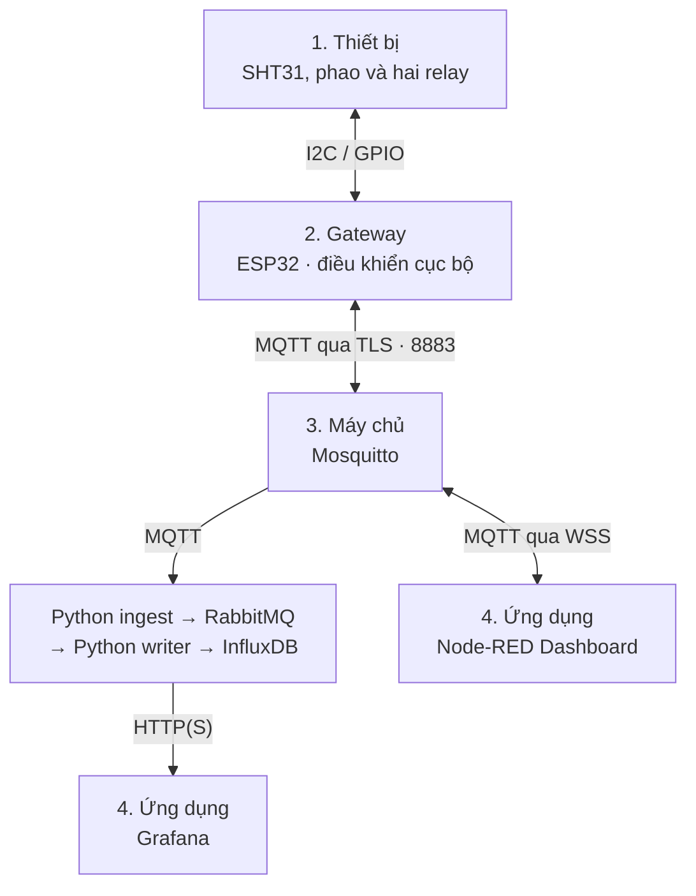

# Humidity Balancer

**Hệ thống cân bằng độ ẩm tự động cho phòng kín · Nhóm 12 “Tam đại con gà”**

Humidity Balancer là đồ án IoT trong lĩnh vực Smart Home. ESP32 đọc độ ẩm tương đối (RH) và nhiệt độ từ SHT31, điều khiển máy tạo ẩm hoặc máy hút ẩm qua relay để giữ độ ẩm trong dải mặc định **40–50% RH**, với điểm đích **45% RH**. Vòng điều khiển chạy trên ESP32 để chế độ Auto tiếp tục hoạt động khi mất Wi-Fi. Dashboard dùng MQTT để theo dõi, nhận cảnh báo và gửi lệnh từ xa.

**Trạng thái kho tại Checkpoint 1:** Tài liệu thiết kế. Firmware, cấu hình triển khai và kết quả kiểm thử tích hợp sẽ được bổ sung theo tiến độ.

## Kiến trúc hệ thống



- **Thiết bị và gateway.** SHT31 đo qua I2C (địa chỉ mặc định `0x44`). Hai công tắc phao báo bình tạo ẩm cạn và bình hút ẩm đầy. Firmware dự kiến dùng Arduino cho ESP32, lập lịch đọc mỗi 5–10 giây bằng `millis()` và tính điểm sương từ RH và nhiệt độ.
- **Máy chủ.** Các dịch vụ chạy bằng Docker Compose. Tiến trình ingest nhận MQTT, kiểm tra JSON rồi đưa dữ liệu vào RabbitMQ qua AMQP 0-9-1. Hàng đợi bền vững và bản tin persistent giữ các bản tin đã vào hàng đợi khi tiến trình ghi tạm dừng. Tiến trình ghi chỉ xác nhận bản tin sau khi ghi thành công vào InfluxDB qua HTTP.
- **Ứng dụng.** Node-RED hiển thị số liệu, trạng thái máy và cảnh báo theo thời gian thực, đồng thời gửi lệnh điều khiển. Grafana hiển thị lịch sử RH và nhiệt độ.

## Điều khiển độ ẩm

| Thiết bị | Điều kiện bật ở chế độ Auto | Điều kiện tắt theo RH | Chạy / nghỉ tối thiểu |
| --- | --- | --- | --- |
| Máy tạo ẩm | RH < 40% | RH ≥ 45% | 60 giây / 60 giây |
| Máy hút ẩm | RH > 50% | RH ≤ 45% | 2 phút / ít nhất 3 phút |

Ngưỡng bật và tắt khác nhau tạo độ trễ (hysteresis), giúp relay tránh đóng ngắt liên tục quanh một ngưỡng. Bộ điều khiển xét thời gian chạy/nghỉ tối thiểu khi chuyển trạng thái bình thường và chờ khoảng 30 giây khi chuyển giữa hai máy. Máy trạng thái dự kiến gồm `BOOT_DELAY`, `IDLE`, `HUMIDIFYING`, `DEHUMIDIFYING` và `FAULT`.

- **Liên động và khởi động.** Chỉ một máy được phép chạy tại một thời điểm. Khi khởi động lại, cả hai relay ở trạng thái tắt cho đến khi có số đo hợp lệ và hết thời gian chờ khởi động.
- **Bảo vệ ưu tiên.** Tắt máy tạo ẩm khi RH ≥ 70% hoặc bình cạn. Tắt máy hút ẩm khi RH ≤ 30% hoặc bình đầy. Nếu không có số đo hợp lệ trong 60 giây, tắt cả hai máy và vào `FAULT`.
- **Điều khiển tay.** Lệnh bật tay mặc định hết hạn sau 30 phút rồi hệ thống trở về Auto. Liên động và giới hạn an toàn áp dụng ở cả hai chế độ.
- **Cảnh báo.** Dashboard dự kiến hiển thị cảnh báo bình cạn, bình đầy, lỗi cảm biến, mất kết nối và nguy cơ nấm mốc khi RH duy trì trên 70% quá một giờ.

## Giao tiếp MQTT

Mỗi thiết bị có nhóm topic riêng dưới tiền tố `home/humidity/<device_id>/`. Bảng sau mô tả giao thức dự kiến.

| Hậu tố | Hướng | Nội dung | QoS | Retain |
| --- | --- | --- | --- | --- |
| `meta` | ESP32 → broker | Thông tin thiết bị, cảm biến và ngưỡng mặc định | 1 | Có |
| `telemetry` | ESP32 → broker | RH, nhiệt độ, điểm sương, RSSI | 0 | Không |
| `status` | ESP32 → broker | Online/offline, chế độ, trạng thái máy và cảnh báo | 1 | Có |
| `cmd` | Dashboard → ESP32 | Đổi chế độ, bật/tắt, đổi ngưỡng, hiệu chỉnh offset, xóa lỗi | 1 | Không |
| `cmd/ack` | ESP32 → dashboard | Kết quả xử lý lệnh theo `cmd_id` | 1 | Không |
| `config` | Broker → ESP32 | Cấu hình ngưỡng, bộ định thời và offset | 1 | Có |

ESP32 dự kiến gửi telemetry mỗi 10–30 giây và ngay khi trạng thái hoặc cảnh báo thay đổi. Thiết bị công bố `online: true` sau khi kết nối. Last Will and Testament (LWT) cập nhật `online: false` khi broker phát hiện kết nối bị ngắt bất ngờ.

```json
{
  "ts": "2026-10-08T21:00:05+07:00",
  "rh": 46.2,
  "t": 27.1,
  "dew_point": 14.5,
  "wifi_rssi": -60
}
```

Mỗi lệnh có `cmd_id` duy nhất để phát hiện lệnh trùng và đối chiếu phản hồi. Khi đổi ngưỡng, firmware kiểm tra các giá trị nằm trong 20–80% RH, `high - low` tối thiểu 5 điểm phần trăm và `low < target < high`. Thiết kế dùng MQTT qua TLS (cổng 8883), tài khoản riêng và ACL theo thiết bị. Dashboard yêu cầu đăng nhập và thông tin xác thực được nạp từ cấu hình ngoài mã nguồn.

## Phần cứng dự kiến

| Linh kiện | Số lượng | Vai trò |
| --- | --- | --- |
| ESP32 DevKit | 1 | Đọc cảm biến, điều khiển relay và kết nối MQTT |
| SHT31 | 1 | Đo RH và nhiệt độ |
| Công tắc phao | 2 | Phát hiện bình tạo ẩm cạn và bình hút ẩm đầy |
| Module relay hai kênh cách ly quang | 1 | Đóng ngắt hai máy qua tiếp điểm thường mở (NO) |
| Adapter 5 V có chứng nhận | 1 | Cấp nguồn cho mạch điều khiển |
| OLED I2C | 1, tùy chọn | Hiển thị tại chỗ |

Checkpoint 1 ước tính khoảng **690.000 đồng** cho linh kiện, vật tư lắp ráp và dụng cụ hiệu chuẩn, chưa tính hai máy. Trước khi chọn relay, kiểm tra hai máy có tự chạy lại khi được cấp điện trở lại. Phần điện lưới cần được người có chuyên môn kiểm tra trước khi cấp điện.

## Demo và kiểm thử dự kiến

1. **Mô phỏng Wokwi.** Dùng DHT22 thay SHT31, hai công tắc trượt thay phao và hai LED thay relay. Với Auto và bộ định thời đã sẵn sàng, đặt RH lần lượt ở 35%, 45%, 55% và 45%. Kiểm tra máy tương ứng bật khi vượt ngưỡng khởi động, tắt ở điểm đích sau khi thỏa thời gian chạy tối thiểu và hai LED không sáng đồng thời.
2. **Theo dõi bằng MQTTX.** Đăng ký `home/humidity/#` để xem telemetry và trạng thái. Ngắt kết nối mô phỏng để kiểm tra LWT. Trong mô phỏng mất Wi-Fi, kiểm tra vòng điều khiển cục bộ vẫn chạy.
3. **Tích hợp máy chủ và dashboard.** Kiểm tra lịch sử trên Grafana, phản hồi lệnh hợp lệ và lệnh bị từ chối trên Node-RED. Tạm dừng tiến trình ghi để kiểm tra các bản tin đã vào hàng đợi được xử lý khi tiến trình chạy lại.
4. **Thử trên phần cứng.** Hiệu chuẩn SHT31 với ẩm kế tham chiếu và phép thử muối ở khoảng 75% RH. Kiểm tra bình cạn, bình đầy, mất số đo, khởi động lại và điều khiển trong phòng thực tế.

Mục tiêu kiểm thử gồm sai số sau hiệu chuẩn trong **±3 điểm phần trăm RH**, phản hồi lệnh **≤ 2 giây** trong điều kiện mạng bình thường và dashboard cập nhật dữ liệu **≤ 30 giây**.

## Cấu trúc kho

Các thư mục dưới đây có hướng dẫn ngắn cho từng phần. Các dịch vụ sẽ được khai báo trong Compose khi có cấu hình triển khai.

| Đường dẫn | Nội dung |
| --- | --- |
| [`firmware/`](firmware/) | Firmware ESP32 và cấu hình mô phỏng |
| [`server/ingest/`](server/ingest/) | Nhận MQTT, kiểm tra JSON và đưa bản tin vào RabbitMQ |
| [`server/writer/`](server/writer/) | Nhận bản tin từ RabbitMQ và ghi vào InfluxDB |
| [`dashboard/`](dashboard/) | Flow Node-RED và dashboard Grafana |
| [`docs/`](docs/) | Đặc tả yêu cầu, sơ đồ đấu nối và tài liệu kiểm thử |
| [`docker-compose.yml`](docker-compose.yml) | Khung khai báo dịch vụ máy chủ |
| [`.env.example`](.env.example) | Mẫu biến môi trường cho dịch vụ máy chủ |
